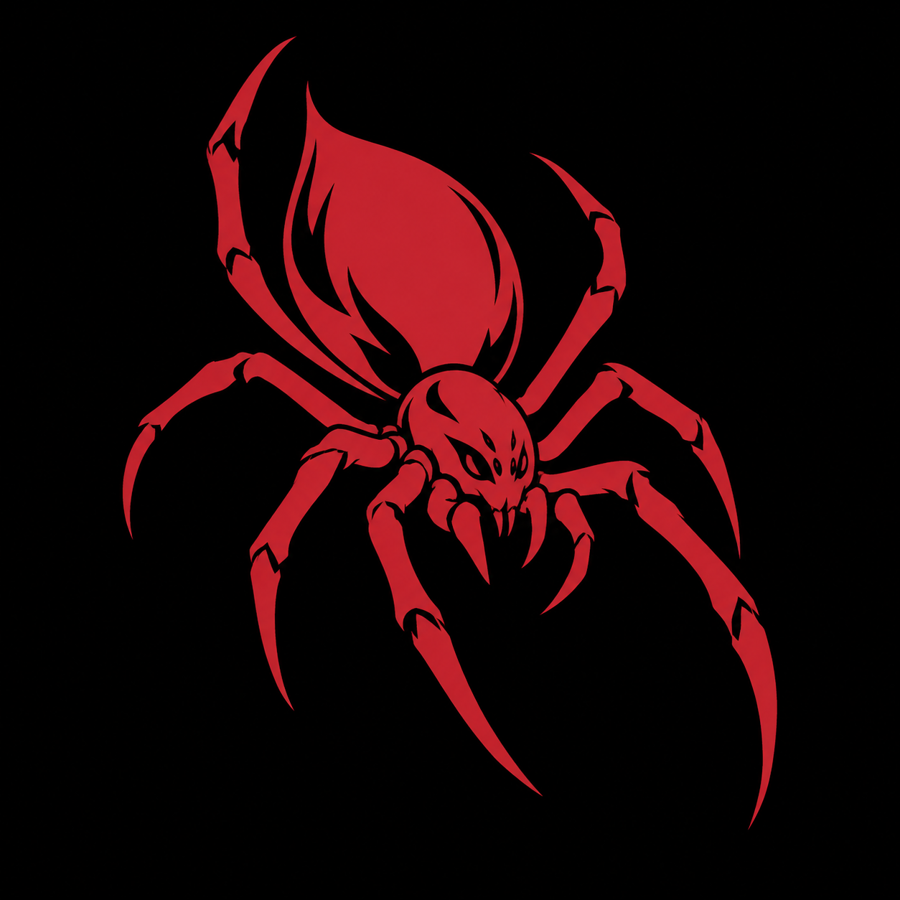

PWBE

---

# PWBE

## Sobre o projeto

Material de estudo de programação web back-end. A raiz reúne o arquivo `Node.js` e a imagem `Nodejs.png`.

## Como explorar

Consulte o arquivo `Node.js` e a imagem de apoio. A raiz não contém `package.json`, portanto não há um comando npm de inicialização definido.

## Mapa do repositório

- [Node.js](Node.js)
- [Nodejs.png](Nodejs.png)

## Desenvolvimento

As instruções acima descrevem os arquivos disponíveis. A execução da aplicação não foi validada nesta revisão de documentação.

---

Estudo · construção · evolução <a href="https://github.com/arthurlynow098">Perfil</a> · <a href="https://arthurentsev.vercel.app/">Portfólio</a>

