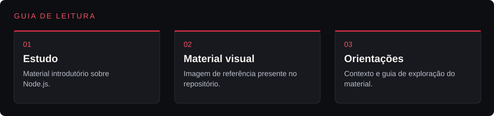
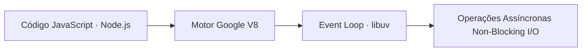
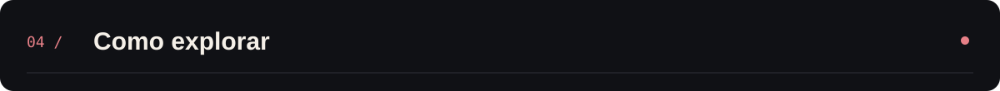

<p align="center">
  
</p>

<p align="center">Material de estudo sobre JavaScript no servidor e execução assíncrona com Node.js.</p>

<p align="center"></p>

<p align="center"><a href="#visão-geral">Visão geral</a> &nbsp;·&nbsp; <a href="#recursos">Recursos</a> &nbsp;·&nbsp; <a href="#como-explorar">Como explorar</a></p>

---

<a id="explore-o-projeto"></a>




| Área | O que você encontra | Acesso direto |
|---|---|---|
| **Estudo** | Material introdutório sobre Node.js. | [Abrir estudo →](Node.js) |
| **Material visual** | Imagem de referência presente no repositório. | [Abrir material visual →](Nodejs.png) |
| **Orientações** | Contexto e guia de exploração do material. | [Abrir orientações →](README.md) |

<a id="visão-geral"></a>


O repositório **PWBE (Programação Web Back-End)** registra a introdução ao desenvolvimento de servidores utilizando **Node.js**, compreendendo como o motor V8 do Google e a arquitetura *Event Loop Single-Thread Non-Blocking I/O* permitem processar requisições concorrentes com alto desempenho.

<a id="recursos"></a>


| Elemento | Descrição |
|---|---|
| Node.js | Script e anotações fundamentais sobre inicialização e execução no ambiente Node. |
| Nodejs.png | Referência visual de apoio aos conceitos estudados na disciplina de Programação Web Back-End. |

<details>
<summary>Arquitetura do Runtime estudado</summary>



</details>

<details>
<summary>Estrutura do repositório</summary>

```text
PWBE/
├── assets/
│   └── banner-v2.png               Banner do projeto
├── Node.js                         Arquivo de estudo e código Node.js
├── Nodejs.png                      Diagrama / imagem de referência
└── README.md
```

</details>

<a id="como-explorar"></a>



1. Clone o repositório:
   ```bash
   git clone https://github.com/arthurlynow098/PWBE.git
   cd PWBE
   ```
2. Consulte o arquivo Node.js e execute-o com o runtime instalado (node Node.js).

---

<p align="center">
  <a href="https://github.com/arthurlynow098">GitHub</a> &nbsp;·&nbsp;
  <a href="https://arthurentsev.vercel.app/">Portfólio</a> &nbsp;·&nbsp;
  <a href="https://www.linkedin.com/in/entsevarthur/">LinkedIn</a>
</p>
