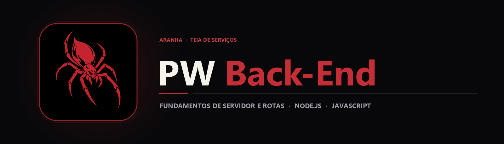

  

  Material de estudo de Programação Web Back-End (PWBE) dedicado aos fundamentos do runtime Node.js e execução de JavaScript fora do navegador.

  
  
  

## Sobre o projeto

O repositório **PWBE (Programação Web Back-End)** registra a introdução ao desenvolvimento de servidores utilizando **Node.js**, compreendendo como o motor V8 do Google e a arquitetura *Event Loop Single-Thread Non-Blocking I/O* permitem processar requisições concorrentes com alto desempenho.

## Principais recursos

| Elemento | Descrição |
|---|---|
| Node.js | Script e anotações fundamentais sobre inicialização e execução no ambiente Node. |
| Nodejs.png | Referência visual de apoio aos conceitos estudados na disciplina de Programação Web Back-End. |

## Tecnologias

  
  

## Arquitetura do Runtime estudado

`mermaid
flowchart LR
    A[Código JavaScript · Node.js] --> B[Motor Google V8]
    B --> C[Event Loop · libuv]
    C --> D[Operações Assíncronas Non-Blocking I/O]
`

## Estrutura do repositório

`	ext
PWBE/
├── assets/
│   ├── banner.png                  Banner principal PW Back-End
│   └── project-animal.png          Símbolo da aranha
├── Node.js                         Arquivo de estudo e código Node.js
├── Nodejs.png                      Diagrama / imagem de referência
└── README.md
`

## Como explorar

1. Clone o repositório:
   `ash
   git clone https://github.com/arthurlynow098/PWBE.git
   cd PWBE
   `
2. Consulte o arquivo Node.js e execute-o com o runtime instalado (
ode Node.js).

---

Estudo · construção · evolução <a href="https://github.com/arthurlynow098">Perfil</a> · <a href="https://arthurentsev.vercel.app/">Portfólio</a> · <a href="https://www.linkedin.com/in/entsevarthur/">LinkedIn</a>

